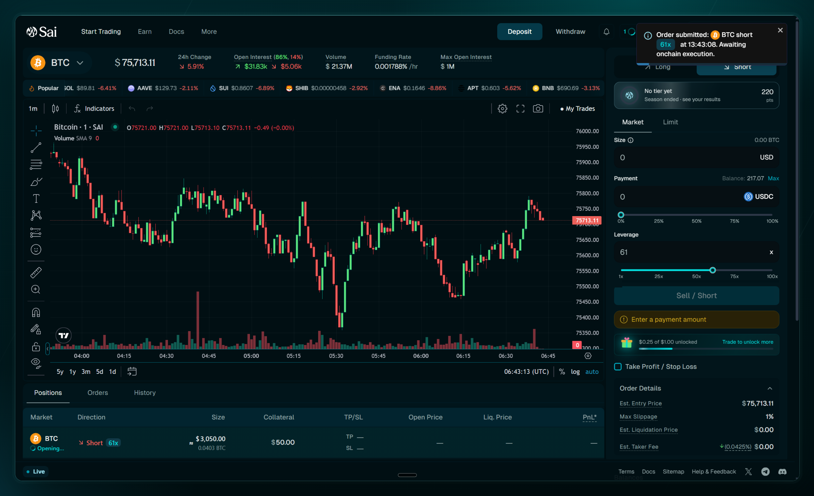
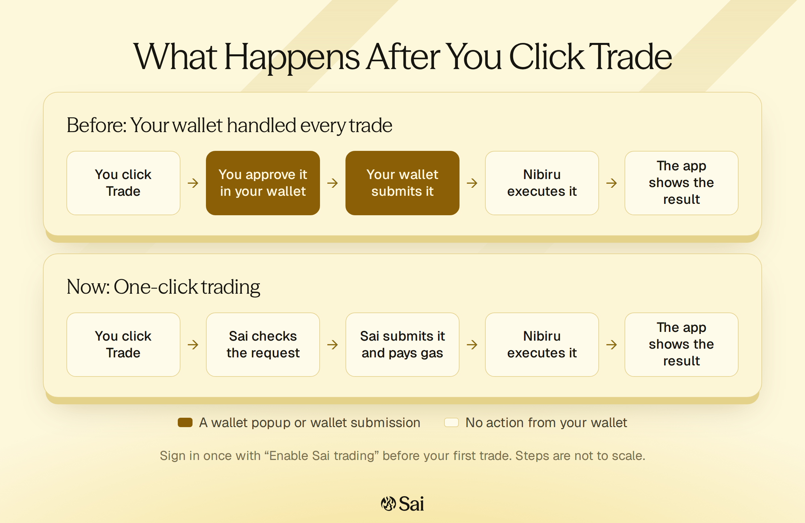
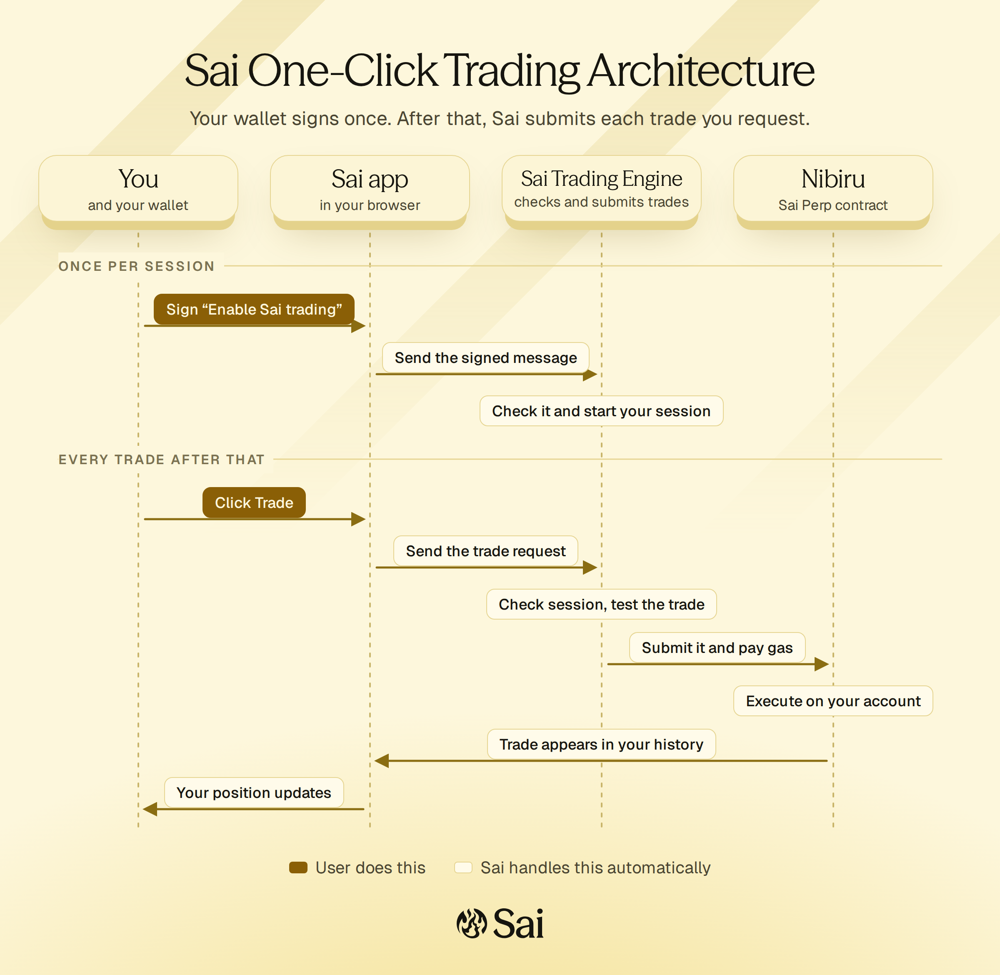
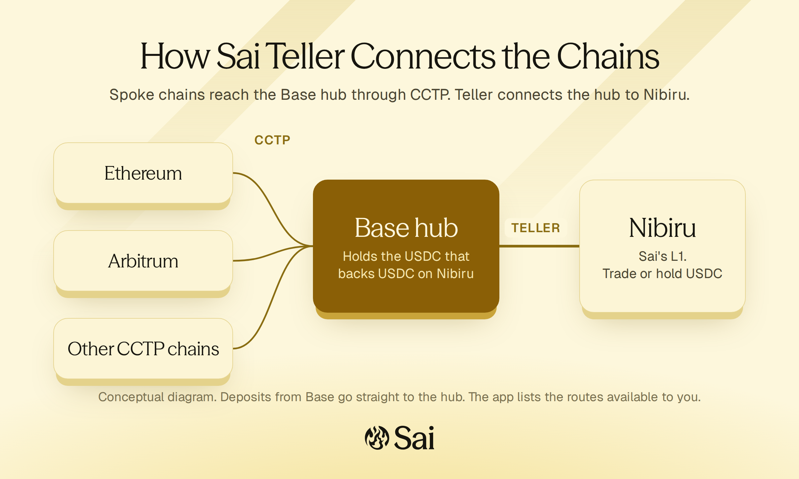

I founded Sai, a perpetual futures exchange, and I built most of its core. The
trading engine, the liquidity vault, and the rules that decide when a position
is liquidated are largely my design and my code. I also run the company.

Sai has handled over $225 million in trading volume, most of it since
mid-2026. It runs on [Nibiru](/about/nibiru), the blockchain I founded before
it, which let us add the chain features the exchange needed.

<!-- TODO(Unique): One or two sentences on why you started Sai. -->

## What Sai Is

A perpetual future lets a trader bet on a price going up or down, with
leverage, and hold the position as long as they want. On Sai a trader can go
long or short on crypto, stocks, and commodities with up to 100x leverage,
while keeping custody of their own funds.

Traders usually choose between a centralized exchange that is fast and
familiar but holds their money, and a decentralized one that keeps their money
in their hands but is slower and harder to use. Sai is my attempt to remove
that choice:

- **Oracle-settled prices.** Fills and liquidations use a market-wide price,
  not a thin local order book. One large order on one venue can't print a
  wick that liquidates people who were right about the market.
- **One vault on the other side.** Liquidity providers deposit USDC into a
  single vault, the SLP vault, and it takes the other side of every trade. No
  order book needs to be deep before a market can open, so Sai can list a
  stock or a commodity once a reliable price feed exists.
- **Simple costs.** Instead of funding payments in fixed windows, which turn
  funding into a timing game, holding a position costs a small fee that
  updates every block.
- **Speed that feels like a centralized exchange.** One-click trading,
  described below, removed the wallet popup from every trade.

## Building the Core

Sai's core is a set of Rust smart contracts: the perp engine, the SLP vault,
the oracle, and a few smaller contracts around them. The first version came
from an earlier codebase that Oak Security audited in 2024. I took it over and
rebuilt most of it, with a large test suite and a written design for every
major change. In the contract repository alone, I've authored 425 of 668
commits.

Across the five codebases behind Sai and Nibiru, from the contracts and the
trading engine to the web apps and the chain, I've authored over 2,200 commits
and more than 800 merged pull requests, in a stack that runs to millions of
lines of code.

More than a third of the perp engine's code is tests. Any change big enough
to argue about gets a numbered design spec before it gets code, and more than
a dozen of those specs sit next to the contracts.

Three pieces show how I think about this code:

**Positions and totals can't disagree.** An exchange keeps both individual
positions and running totals for each market, and the vault's risk
calculations depend on those totals. Several code paths used to update both,
so they could quietly drift apart whenever someone forgot one place. I moved
every open, close, and partial close behind a single write path. Now the
totals can't drift, and every new feature gets correct bookkeeping without
having to remember it.

**Liquidation is a last resort.** A position is liquidated only after losses
and fees have used up about 90% of its collateral. The liquidation price is
deterministic and includes fees, so a trader can see exactly where it is. The
contracts reject stop-losses that could only fire after liquidation, and anyone
can trigger an eligible liquidation, so the exchange doesn't depend on one bot
staying online.

**Stocks close; crypto doesn't.** When a stock's home market is closed, Sai
tightens the leverage a position can effectively use. That limits how much a
weekend price gap can cost traders and the vault when the market reopens.

Smaller systems I designed around the engine include USDC trading credits,
which let us give a trader real capital that only becomes withdrawable once
the terms of their deal are met, and a referral system whose earnings follow
the referral code rather than the wallet that owns it.

## Keeping the Vault Healthy

Because the SLP vault takes the other side of every trade, it pays when
traders win. Its fees have to cover that over time, or liquidity providers
leave and the exchange can't function.

So I treated fee design as a research problem. I built a tool that replays
Sai's real trading history against candidate fee designs and compares what
each one would have collected with what the vault actually paid out. I ran it
across calm periods and our most stressful ones, then swept the parameters to
find a design that held up everywhere rather than one that looked good on a
single window.

The result has two parts, both of which I implemented in the contracts. An
exposure fee charges positions in proportion to the one-sided risk they place
on the vault, so large crowded positions pay the most and small ones pay
little. A profit share takes a small cut when a trade closes in profit, costs
nothing on a losing trade, and scales with exactly the outcome that drains
the vault. Fees also used to sit in the contract until someone moved them.
They now flow into the vault on their own every ten blocks, using block hooks
I added to the chain.

## One-Click Trading

The feedback we hear most from traders is about speed. Nibiru executes
transactions quickly, but a trader experiences the whole trip: click, approve
in the wallet, wait for the wallet to submit, wait for execution, wait for the
app to catch up. Some actions took more than ten seconds, and the wallet popup
sat in the middle of every trade.

I led the redesign, which touched all three Sai codebases. A trader now signs
one message, titled **Enable Sai trading**, the first time they trade. It
isn't a transaction, costs no gas, and approves no token spending. After that,
each click sends a signed request to Sai's trading engine, which checks it,
simulates it against the contract, and submits it, paying the gas itself. The
contract still executes the trade on the trader's own account, with their own
balance. I wrote much of this myself, including the signed trade requests in
the trading engine and the web app's rebuilt trading module, which shrank from
2,672 lines to 352. The rest of the engineering team built out the engine's
services with me.

## Funding From Any Chain

Trading is the second step. The first is getting money onto the exchange, and
that is where many people quit. I remember someone who moved their funds to
try Sai and then gave up, because there were still too many steps between them
and a first trade.

Sai Teller is our answer, and I designed its contract side. A trader picks the chain their USDC is on and
deposits, the way they would on a centralized exchange. Base is the hub.
Other chains send USDC to Base through Circle's Cross-Chain Transfer Protocol,
and Teller connects Base to Nibiru. A deposit can go straight into a trader's
Sai balance, and the contracts let them start trading before the cross-chain
transfer fully settles while holding back withdrawal until it does.

## The Chain Underneath

Owning the chain under an exchange is unusual, and it changed what we could
build. When Sai needed something the chain didn't offer, I could add it.
Block hooks are a good example. I made it possible for a governed contract to
run at the start and end of every block, and Sai's vault snapshots and fee
settlement run on them with no bot to keep alive. My
[Rust and WebAssembly work](/code/projects/nibiru-rust) covers more of that
foundation.

Owning the chain also means owning its emergencies. When a vulnerability in
the WebAssembly runtime was disclosed to us privately, a real fix meant
building and rolling out a new runtime, which takes weeks. We didn't wait. We
hardened the node binaries first, then restricted who could deploy contracts,
and I shipped the repaired runtime last, each layer as soon as it was ready.

The chain work I find most interesting is block lanes. Each block is built in
a fixed order, with Sai's oracle price
updates first and its keeper and liquidation calls next. When a block contains a new price, every trade after
it executes against that price. The fast lanes are capped at a quarter of the
block so they can't crowd anyone out, and they never reorder one account's
own transactions.

## Running the Company

I run Sai. I lead the engineers and the sales team, hire and
let people go, manage the company's money, and decide what we build next.

Our sales team closes deals with traders, and those deals carry real terms,
such as trading credits, fee discounts, and referral arrangements. I built Sai
Deal Desk, the system the team uses to
record those terms, track payments, and keep evidence for every action an
admin takes, so a deal agreed in a chat ends up as exact, auditable state.

Initiatives I led to grow the exchange include trading competitions, an
ambassador program, and Sai Points, a rewards program for every trade. For
Points I built the payout tooling, which unlocks each reward gradually as the
trader keeps trading instead of paying it out at once.

## Source Code

Sai's repositories are private, so these links only work for the Sai team.
Nibiru's is public.

- [Sai contracts](https://github.com/NibiruChain/sai-perps)
- [Sai keeper and indexer](https://github.com/NibiruChain/sai-keeper)
- [Sai web app and docs](https://github.com/NibiruChain/sai-web)
- [Nibiru](https://github.com/NibiruChain/nibiru)
