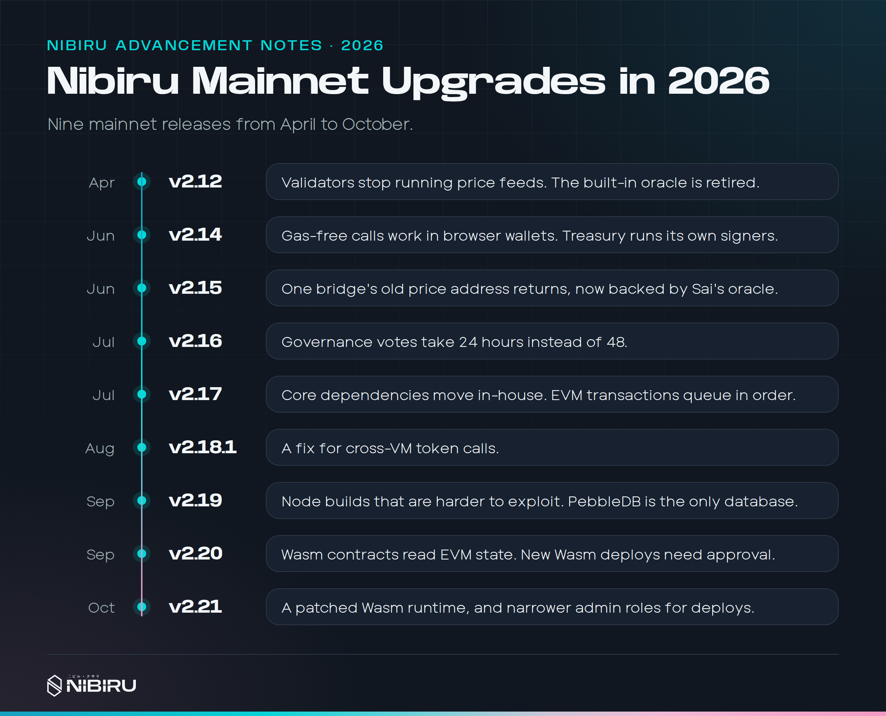
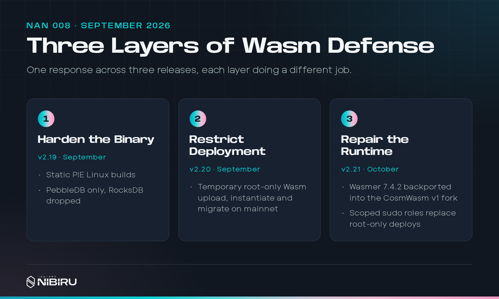
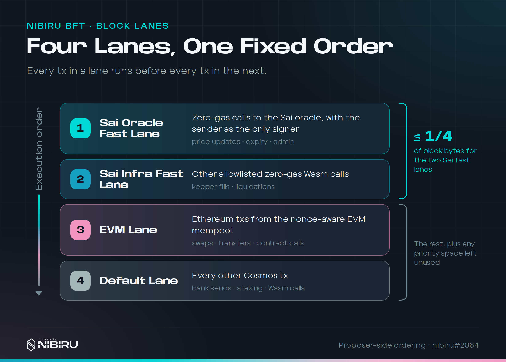
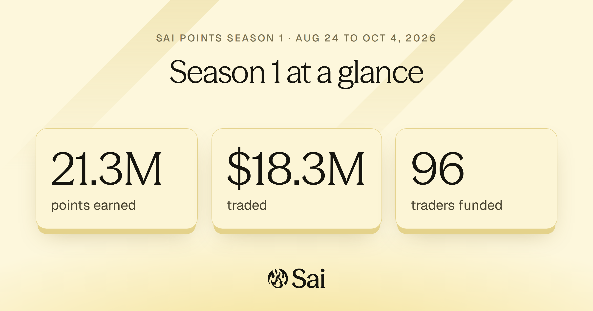

Sai is a perpetual futures exchange. Traders go long or short with leverage on
crypto, stocks, and commodities. They keep custody of their funds, and every
trade settles at an oracle price that tracks the global market. As of November
6, 2026, Sai's public stats API reports $225.9 million in all-time trading
volume across 29,738 trades from 363 traders.

I founded Sai and lead its engineering. I write a large share of the contract
code myself, and I work across the trading app, the services behind it, and
the chain it runs on, alongside product and running the company.

## What Sai Is For

Perpetual futures are most of crypto trading now, and traders still have to
choose between two bad options. A centralized exchange is fast and familiar,
but it holds your money, its liquidation logic is a black box, and it can stop
withdrawals. A decentralized exchange keeps your money in your hands, but it's
usually slower, harder to use, and full of mechanics a trader has to learn
before placing a first order.

Sai's bet is that you don't have to give up either side. A handful of design
choices carry most of the weight:

- **Oracle-settled pricing.** Fills and liquidations use a market-wide price,
  not a thin local order book. A single large order on one venue can't print a
  wick that liquidates people who were never wrong about the market.
- **A continuous borrow fee.** Many perps platforms charge funding in fixed
  windows, which turns funding into a timing game. On Sai, the cost of holding
  a position updates every block based on open interest, so traders pay a
  clear, predictable rate.
- **Single-asset liquidity vaults.** Liquidity providers deposit USDC into the
  SLP vault and earn from real trading activity without managing token pairs.
  The vault is the counterparty to every trade.
- **Any market with a good price feed.** Because pricing comes from an oracle
  and liquidity is pooled, Sai can list a stock, a commodity, or an index as
  soon as a reliable feed and enough demand exist. Stock perps went live in
  April 2026.

## The Contracts

Sai's core is a set of Rust smart contracts: the perp engine, the SLP vault,
the oracle, and several smaller contracts around them. The first version came
from an earlier codebase that Oak Security audited in October 2024. I've
written most of what's there now: about two thirds of all commits, and roughly
the same share of the contract code. The perp crate alone is about 93,000
lines of Rust, more than a third of it tests, with over 900 test functions.
More than a dozen numbered design specs live next to the code, one for each
change big enough to need a written argument first.

Some of the pieces I'm proudest of:

**One place that writes trades.** Every open, close, and partial close now
goes through a single write path. Before that, several code paths each
updated a trade and the market totals derived from it, and keeping them in
agreement relied on every author remembering every place. With one boundary,
per-market position totals can't drift away from the positions they
summarize, and new features get the bookkeeping for free.

**Liquidations as a last resort.** A position is liquidated only after losses
and fees have consumed about 90% of its collateral. The liquidation price is
deterministic and includes fees, so a trader can see exactly where it is.
Stop-loss orders are checked so they can't be set to trigger only after
liquidation, and anyone can trigger an eligible liquidation, so execution
doesn't depend on a single bot staying online. When markets move fast, the
keeper executes triggers in batches.

**USDC trading credits.** Some deals give a trader real USDC as trading
capital. The contracts track that capital separately from the trader's own
deposits, so it trades like any other balance but only becomes withdrawable
once the deal's conditions are met.

**Referrals.** Referral fees are keyed by the referral code, not by the wallet
that happens to own it, so a code can change hands without stranding what it
earned. Lifetime accounting and events let the indexer and the app show every
referrer exactly what they've earned.

**Stock markets after hours.** Crypto never closes, but the stock market does.
When an underlying market is closed, Sai tightens effective leverage, which
limits how much a weekend price gap can cost traders and the vault when
trading reopens.

## Paying for the Other Side of Every Trade

The SLP vault is the counterparty to every trade on Sai. When traders win, the
vault pays. If the fees it collects don't cover what it pays out over time,
liquidity providers lose money and leave, and without liquidity there is no
exchange.

In late October 2026 I went deep on this question. I built a research harness
in Python that replays real trading history from Sai's indexer against
candidate fee designs and compares what each design would have collected with
what the vault actually paid. I ran it across calm stretches and our worst
historical windows, then swept the main parameters to see which designs held
up and which only looked good on one period.

The design that came out of it, and that I then implemented in the contracts,
has two parts:

- **An exposure fee.** Positions pay in proportion to how much one-sided risk
  they place on the vault, measured against a fixed reference size. Large,
  crowded positions pay the most, and small ones pay little.
- **A share of profits after costs.** When a trade closes in profit, a small
  share of that profit goes to the vault. It costs nothing on losing trades,
  and it scales with exactly the outcome that drains the vault.

Fees also used to sit in the contract until someone moved them. They now flow
into the vault automatically every ten blocks, using block hooks I added to
the chain (more on those below). The release went live on mainnet on November
2, 2026.

## One-Click Trading

We talk to Sai traders constantly, and the feedback that comes up most is
speed. Some actions used to take more than ten seconds before the result
appeared in the app. Nibiru executes transactions quickly, but a trader
experiences the whole trip: click, approve in the wallet, wait for the wallet
to submit, wait for execution, wait for the app to catch up. The wallet popup
sat in the middle of every trade.

So we changed how trades move through Sai. Now a trader signs one
[EIP-712](https://eips.ethereum.org/EIPS/eip-712) message, titled **Enable Sai
trading**, the first time they trade. It isn't a transaction, costs no gas,
and approves no token spending. After that, each click sends a signed request
to the Sai Trading Engine. The engine checks the request, tests it against the
contract, and a dedicated Sai account submits it and pays the gas. The
contract executes the trade on the trader's own account, with their own
balance.

This touched all three Sai codebases: the contracts, the keeper services, and
the web app. Rebuilding the app's trading module around intents let me cut it
from 2,672 lines to 352. Traders noticed. A week after it reached mainnet, one
told us trades had been smooth ever since.

## Funding From Any Chain

Trading is only the second step. The first is getting money onto the
exchange, and that is where people quit. I remember someone who wanted to try
Sai, moved their funds, and gave up because there were still too many steps
between them and their first trade.

Sai Teller brings the cross-chain transfer into Sai's own funding flow, the
way a centralized exchange lets you pick a network and deposit. Base is the
hub. Other chains send USDC to Base through Circle's Cross-Chain Transfer
Protocol, which burns USDC on one chain and mints it on the other, and Teller
connects Base to Nibiru. A deposit can go straight into a trader's Sai
balance, ready to trade, or arrive as USDC in their own wallet on Nibiru.

Cross-chain transfers take time to settle. The contract design lets a trader
start trading with a verified deposit before settlement finishes, while
holding back withdrawal of that amount until settlement completes.

## The Chain Under Sai

I also founded Nibiru, the blockchain Sai runs on, and many of Sai's hardest
problems were really chain problems. In 2026 we shipped nine mainnet releases
between April and October, most of them shaped by what Sai needed. I write the
[Nibiru Advancement Notes](https://nibiru.fi/docs/ecosystem/updates/nan-007)
that explain each one.

A few that mattered most for the exchange:

- **Retiring the chain's built-in oracle.** Validators used to vote on prices
  and get slashed for missing votes. We moved price feeds to Sai's oracle and
  took validators out of the price business entirely.
- **Owning our dependencies.** The Cosmos SDK, IBC, the Wasm module, and the
  Wasm VM now live as first-party source in the Nibiru repository, so one pull
  request can fix a bug that spans all of them. We also published our first
  fork of the Wasm runtime to fix an ARM64 crash that blocked Sai's largest
  contracts.
- **Block hooks.** A governed contract can schedule privileged calls at the
  start and end of every block. Sai's vault snapshots and automatic fee
  settlement run on them, with no bot to keep alive.
- **A month spent on speed.** In August 2026, making trading feel instant was
  engineering's only priority. Sai got much faster on return visits, trades
  show up the moment you click, and mainnet blocks came back to about 1.5
  seconds from 2.66 in July.

In September, a vulnerability in the compiler behind CosmWasm's Wasm runtime
was disclosed to us privately. A crafted contract could escape the sandbox and
run native code inside a node. A real fix meant a new runtime, which takes
time to build, test, and roll out to every validator, so we didn't wait for
it. We shipped three layers, each as soon as it was ready: harder node
binaries, then restricted contract deployment, then the repaired runtime in
October.

The work I'm deepest in right now is block lanes. A proposer builds every
block in a fixed order, with Sai oracle price updates first and Sai's keeper
and liquidation calls next, ahead of everything else. When a block contains a
price update, every trade after it executes against the new price. The fast
lanes are capped at a quarter of each block so they can't crowd anyone out,
and lanes never reorder one account's own transactions.

## Growing the Exchange

An exchange is only as good as the people trading on it, so a lot of my time
also goes into growth. We ran trading competitions: Let's Go Saicho, with a
$25,500 prize pool, the Sai Cookout across crypto, stocks, and commodities,
and the Sai Grand Cup, where traders competed for their region. We started
the SaiClone ambassador program, and in August 2026 we launched Sai Points,
which rewards every trade.

Season 1 ran from August 24 to October 4, 2026. Traders earned 21.3 million
points on $18.3 million in volume, and 96 of them received rewards. I built
the payout tooling, which unlocks each reward as the trader keeps trading
instead of paying it all out at once.

## Source Code

Sai's repositories are private, so these links only work for the Sai team.
Nibiru's is public.

- [Sai contracts](https://github.com/NibiruChain/sai-perps)
- [Sai keeper and indexer](https://github.com/NibiruChain/sai-keeper)
- [Sai web app and docs](https://github.com/NibiruChain/sai-web)
- [Nibiru](https://github.com/NibiruChain/nibiru)
